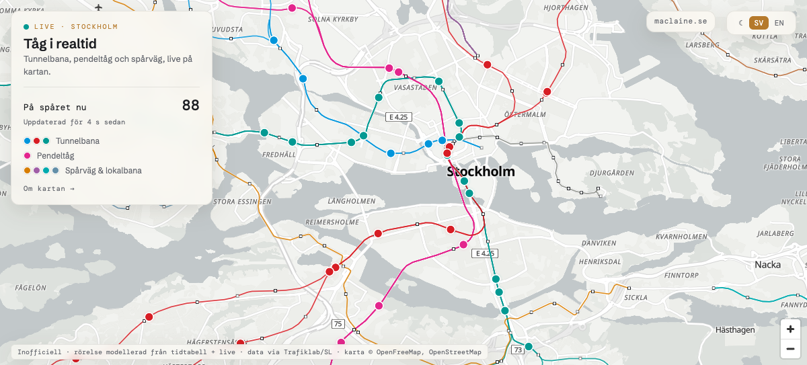
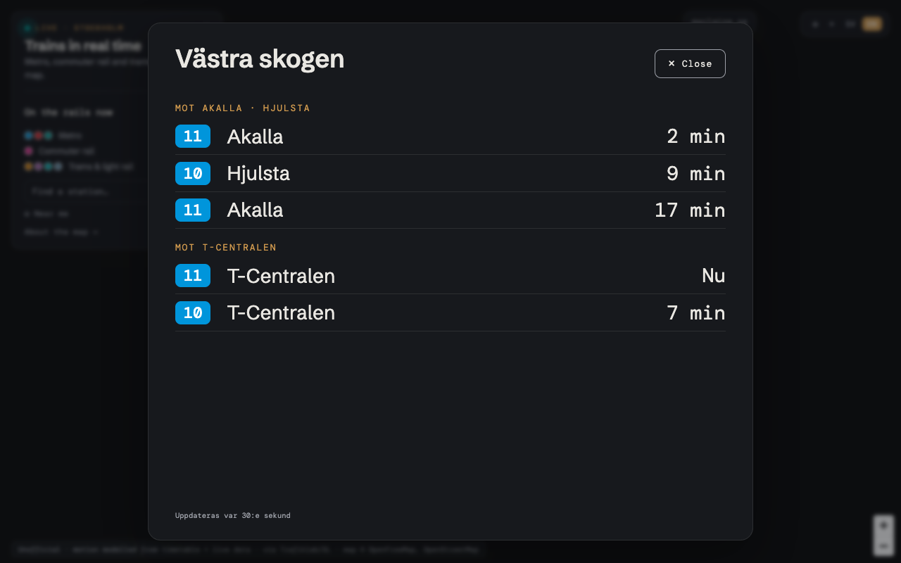
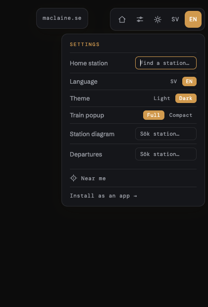

# Stockholm SL Map

**Live map of Stockholm's rail traffic — every metro, commuter train, tram and light-rail service, gliding along the real tracks.**

**→ [maclaine.se/stockholm-sl-map](https://maclaine.se/stockholm-sl-map)** (Swedish) · **[English](https://maclaine.se/en/stockholm-sl-map)** · [About the map](https://maclaine.se/stockholm-sl-map/about) · [Install as an app](https://maclaine.se/stockholm-sl-map/app)



Free, no account, no tracking of you (only of the trains). Runs entirely on free tiers; the monthly bill is zero kronor.

## What it does

- **Live positions every 5 seconds** for the whole SL rail network: metro (tunnelbana), commuter rail (pendeltåg), trams and light rail (Tvärbanan, Roslagsbanan, Saltsjöbanan, Lidingöbanan, Nockebybanan, Spårväg City) — in SL's real line colours, with the line number on every train.
- **Real track geometry.** Lines are routed along actual rails from OpenStreetMap, tunnels included — not curves guessed between stations.
- **Trains glide, they don't jump.** A motion engine anchors each train to its last believable GPS fix and advances it along the track at timetable pace, easing corrections smoothly.
- **Click a station** for live departures split by direction; **click a departure** to fly to that exact train on the map. **Click a train** for its next stops, lateness against the timetable, and a follow mode that pins the camera to it.
- **Full-screen departure boards**, a pinned home station that opens on launch, station search that forgives missing å/ä/ö, dark mode, English/Swedish, and installation to a phone home screen as a standalone app with an offline shell.
- **Honest failure modes.** If the position feed is lost, the map says so and shows timetable estimates — it never animates stale data as if it were live.

<p>
  
  
</p>

## How it works

```
                     ┌────────────────────────────────────────────┐
 nightly (GitHub     │ GTFS Static (Trafiklab)                    │
 Actions, 02:25) ──▶ │  + committed OSM track graph               │
                     │  → gen-lookup: route every line stop-to-   │
                     │    stop over real rail, build trip         │
                     │    schedules as distances along each line  │
                     │  → geometric verification gate             │
                     │  → publish to Cloudflare R2                │
                     └────────────────┬───────────────────────────┘
                                      │
 every 5 s ──▶ GTFS-RT VehiclePositions (Trafiklab)               
                                      │
                     ┌────────────────▼───────────────────────────┐
                     │ two Cloudflare Pages Functions (edge):     │
                     │  /api/sl-vehicles – decode protobuf, join  │
                     │    against the nightly build, return JSON  │
                     │  /api/sl-geometry – lines + stations from  │
                     │    the same build (they must never desync) │
                     └────────────────┬───────────────────────────┘
                                      │
                     ┌────────────────▼───────────────────────────┐
                     │ static page + MapLibre GL                  │
                     │  motion engine: anchor → glide → correct   │
                     └────────────────────────────────────────────┘
```

No servers. A static page, two edge functions that run only when a browser asks, an R2 bucket refreshed once a night, and a scheduled GitHub Action. Everything sits comfortably inside free tiers.

### The three hard problems

**Tracks, not curves.** Timetable data only knows where stations are, so v1 drew elegant arcs straight across open water. Now a committed OpenStreetMap track graph is routed with Dijkstra — with penalized "merge hops" between parallel direction tracks (which OSM maps as separate ways that only meet at crossovers kilometres apart), deterministic tie-breaking so twin tunnel tubes resolve identically for every line, and snap points chosen **jointly per line** (a Viterbi pass over candidate tracks per station) because independent nearest-point snapping kept dragging lines onto each other's tunnels at interchanges. A despiking pass removes routing artifacts while protecting station vertices — line 7 genuinely hairpins at Bellmansro on the Waldemarsudde balloon loop, and geometry that looks like a bug sometimes isn't.

**Motion from a slow feed.** The GPS feed refreshes each vehicle roughly every six seconds and about one fix in twelve is junk (positions implying 600 m/s through the old town). Each train anchors to its last plausible fix, credited with the fix's age (uncredited, the whole fleet trails reality by ~20–30 seconds), then glides along its line at timetable pace. Corrections ease into the drawn position as *time* adjustments, never sideways jumps — so a late train looks like a train running late, not popcorn.

**Departure ↔ train matching.** The departures API and the vehicle feed share no identifiers. Clicking a departure finds its live train by line, destination, and scheduled time at that stop — where "that stop" is matched by *position along the line*, never by name, because the same physical station carries different names per mode (commuter rail calls T-Centralen "Stockholm City").

## Data and credits

| | |
|---|---|
| Live positions | [Trafiklab](https://www.trafiklab.se/) GTFS Regional Realtime, every 5 s |
| Timetables | Trafiklab GTFS Regional Static, rebuilt nightly |
| Track geometry | © [OpenStreetMap](https://www.openstreetmap.org/copyright) contributors |
| Base map | [OpenFreeMap](https://openfreemap.org/) |
| Station diagrams (linked) | [Albert Guillaumes](http://stations.albertguillaumes.cat/) |

**Unofficial.** This map is not affiliated with, endorsed by, or built for SL or Region Stockholm. SL is a trademark of Region Stockholm. Errors and deviations are the map's, not SL's.

## About this repository

This is the project page. The map ships from the same codebase as [maclaine.se](https://maclaine.se/) and is served as plain HTML/JS — view-source on the live page *is* the source. Built by [Matthew MacLaine](https://maclaine.se/), an IT engineer in Stockholm who wanted to watch his own commuter train approach before running to the platform.
